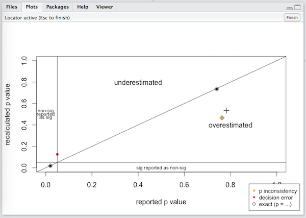
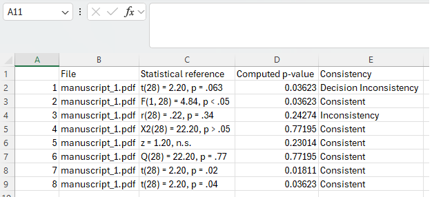
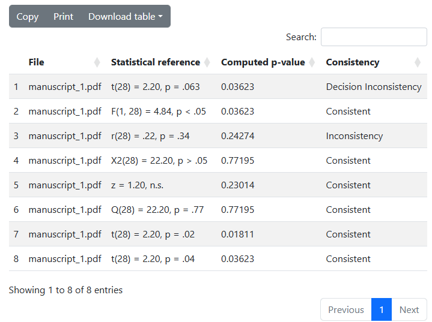
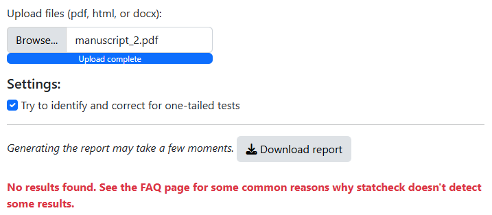
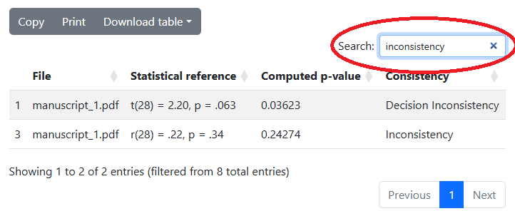
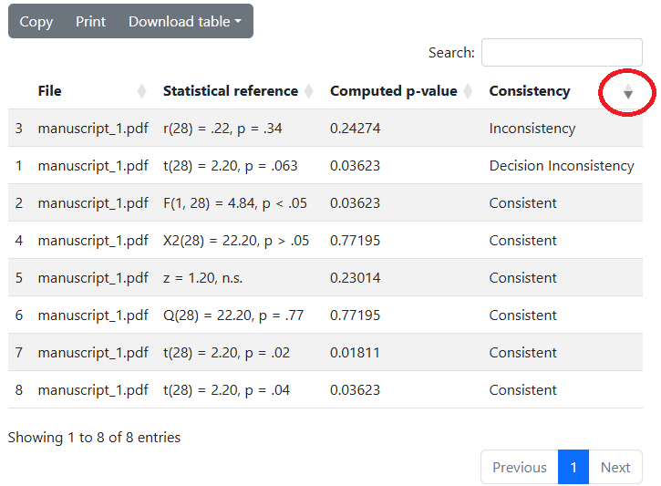

```{r, include = FALSE}
knitr::opts_chunk$set(
  collapse = TRUE,
  comment = "#>"
)
```

```{r setup, include = FALSE}
library(statcheck)
```

```{r, echo = FALSE, out.width = "300px", fig.align = "center"}

```

This manual provides detailed instructions for the installation and use
of the free R package `statcheck`: Extract statistics from articles and
recompute p-values" (Nuijten & Epskamp, 2026). For a more concise manual
check out the R Help files with `?statcheck`.

# What's new in 1.6.1

statcheck now reads PDF files with the R package pdftools. You no longer
need to install the external program Xpdf. Furthermore,
`statcheckReport()` has been rewritten and its argument `outputFileName`
is now called `outputFile`, and a PDF that cannot be read now gives an
error instead of an empty result. See the
[NEWS](https://github.com/MicheleNuijten/statcheck/blob/master/NEWS.md)
for all changes.

# What is statcheck?

`statcheck` is a "spellchecker" for statistics. It checks whether your
*p*-values match their accompanying test statistic and degrees of
freedom.

`statcheck` searches for null-hypothesis significance test (NHST) in APA
style (e.g., *t*(28) = 2.2, *p* \< .05). It recalculates the p-value
using the reported test statistic and degrees of freedom. If the
reported and computed p-values don't match, `statcheck` will flag the
result as an error.


# What can I use statcheck for?

`statcheck` is mainly useful for:

1.  **Self-checks**: you can use `statcheck` to make sure your
    manuscript doesn't contain copy-paste errors or other
    inconsistencies before you submit it to a journal.
2.  **Peer review**: editors and reviewers can use `statcheck` to check
    submitted manuscripts for statistical inconsistencies. They can ask
    authors for a correction or clarification before publishing a
    manuscript.
3.  **Research**: `statcheck` can be used to automatically extract
    statistical test results from articles that can then be analyzed.
    You can for instance investigate whether you can predict statistical
    inconsistencies (see e.g., Nuijten et al., 2017
    <doi:10.1525/collabra.102>), or use it to analyze p-value
    distributions (see e.g., Hartgerink et al., 2016
    <doi:10.7717/peerj.1935>).

# What statcheck can and cannot do

Before I get to the technical parts of installing and using statcheck,
please consider for a moment what statcheck can and cannot do. The
package statcheck is a program that automatically extracts statistics
from articles and recomputes their p-values. It works as follows:

**1. Convert PDF and HTML files to plain text.**

PDF files are converted to plain text with the R package pdftools. HTML
files are read in by R and automatically converted to raw text files.

**2. Scan text for statistical results**

statcheck searches for specific patterns and recognizes statistical
results from correlations and t, F, $\chi^2$, Z tests and Q tests.
statcheck can only read these results if the results are reported
exactly according to the APA guidelines:

- t(df) = value, p = value
- F(df1, df2) = value, p = value
- r(df) = value, p = value
- $\chi^2$ (df, N = value) = value, p = value *(N is optional,*
  $\Delta$G is also included, since it follows a $\chi^2$ distribution)
- Z = value, p = value
- Q (df) = value, p = value *(statcheck can read and distinguishes
  between Q, Qw / Q-within, and Qb / Q-between)*

All regular expressions take into account that test statistics and p
values may be exactly (=) or inexactly (\< or \>) reported. Different
spacing has also been taken into account, and case is ignored.

**3. Use test statistics and degrees of freedom to recompute p value**

By default the recomputed p value is two sided.

**4. Compare reported and recomputed p value**

This comparison takes into account how the results were reported, e.g. p
\< .05 is treated differently than p = .05. Incongruent p values are
marked as an "error". If the reported result is significant and the
recomputed result is not, or vice versa, the result is marked as a
"decision error".

Correct rounding is taken into account. For instance, a reported t value
of 2.35 could correspond to an actual value of 2.345 to 2.354 with a
range of p values that can slightly deviate from the recomputed p value.
statcheck will not count cases like this as errors.

Furthermore, one-sided testing can be taken into account: if somewhere
in the article the words "one-tailed", "one-sided", or "directional" are
mentioned, and the result would have been correct if it was one-sided,
it can be counted as a correctly reported one-sided test (see the
argument `OneTailedTxt` below). However, as [Felix
Thoemmes](https://www.human.cornell.edu/people/fjt36) pointed out to me,
this only works if the one-tailed result was in line with the one-tailed
hypothesis. If you expected a negative effect, but found a positive one,
your p-value would be 1-p/2. Unfortunately statcheck can't recognize
this and will wrongly flag this as an inconsistency.

For a detailed validity study of statcheck, see [Nuijten, Hartgerink,
Van Assen, Epskamp, & Wicherts,
2016](https://doi.org/10.3758/s13428-015-0664-2) and [Nuijten, Van
Assen, Hartgerink, Epskamp, & Wicherts,
2017](https://doi.org/10.31234/osf.io/tcxaj).

Note that statcheck assumes that the p-value is the inconsistent value,
but it could just as well be the case that the test statistic or degrees
of freedom contain a reporting error. statcheck merely detects whether a
set of numbers is consistent with each other.

Also note that corrected statistical results can also cause statcheck to
flag them as inconsistent. For instance, if you want to perform a
Bonferroni correction for multiple testing and multiply your p-value
instead of dividing your $\alpha$, statcheck will flag your result as
inconsistent. This also holds for other corrections in which the test
statistic, degrees of freedom, or p-value are adjusted (such as e.g.,
Greenhouse-Geisser). Note that when using these corrections it is
advised to still report the result in a consistent manner (so don't
report the uncorrected degrees of freedom with the corrected test
statistic and p-value). See [Nuijten et al.,
2017](https://doi.org/10.31234/osf.io/tcxaj) for details on this issue.

Finally, as [Nick Brown](https://www.rug.nl/staff/n.j.l.brown) pointed
out to me, note that some cases are not flagged as an inconsistency,
whereas they might look suspicious to a human reader. For instance, take
the following case:

> We found a significant difference, t(99) = 1.95, p = .05.

Here, the recalculated p-value is actually .054, which contradicts the
claim that this finding is significant. However, statcheck will not flag
this result as an inconsistency, since, well, it's not. If you round
".054" to two decimals, it actually is .05. This is an example of a case
in which a human might raise their eyebrows, but statcheck strictly
adheres to the math: .054 is correctly rounded to .05, and hence not
inconsistent.

# Installation

To use statcheck, you need R, and preferably the R environment RStudio.
You then install the package statcheck from CRAN. You no longer need to
install any other programs to read PDF files.

## R and RStudio

To use statcheck you first need to install R. R is a free programming
language and environment for statistical computing and graphics. You can
download it from <https://cran.r-project.org/>. If you want you can now
run R via RStudio. RStudio is an interface for R and it has several nice
tricks that can make programming in R easier (syntax highlighting, more
point-and-click options, etc.). You can obtain the latest version of
RStudio from <https://posit.co/download/rstudio-desktop/>.

## statcheck from CRAN

You can install and load the R package statcheck with the following
lines of code:

```{r, eval = FALSE}
install.packages("statcheck")
library(statcheck)
```

statcheck is now ready to use!

On Windows and macOS, the package pdftools that statcheck uses to read
PDF files installs automatically. On Linux, you may first need to
install the system library poppler, for instance on Ubuntu or Debian
with `sudo apt-get install libpoppler-cpp-dev`.

## Optional: statcheck from GitHub

statcheck is constantly being updated, which means that the version on
CRAN is not always the latest version. Instead of downloading statcheck
from CRAN, you can also download the latest development version of
statcheck directly from GitHub with the following lines of R code:

```{r, eval = FALSE}
# install.packages("remotes")
remotes::install_github("MicheleNuijten/statcheck")
library(statcheck)
```

# Using statcheck

## Using statcheck on a raw string of text

The most basic function of statcheck is to extract statistics from a raw
string of text, recalculate the p-value, and report back the findings.
In the example below I simply feed statcheck a string of text with some
statistics in it, and it gives me back a table with the results. I'll go
over the results below.

```{r}
txt <- "blablabla the effect was very significant (t(48) = 1.02, p < .05)"
statcheck(txt)
```

While statcheck extracts statistics, it shows a progress bar. You can
turn this off with the argument `messages = FALSE`. I'll do that in the
rest of this manual to keep the output readable.

Note that when you want to scan a Z test at the very start of a string,
you need to place a space in front of Z. This is because of an ugly hack
I had to build in: sometimes Z tests were read as $\chi^2$ and this was
the easiest way to avoid that:

```{r, eval = FALSE}
statcheck("z = 1.95, p = .05")

# instead, type

statcheck(" z = 1.95, p = .05")
```

The output table is quite large, and because of the screen size it often
gets divided over several lines (as is the case above). This can make
the output a bit hard to read. If you only want to see the most
important columns, you can use the function `trim()`:

```{r}
stat <- statcheck(txt, messages = FALSE)
trim(stat)
```

I'll go over the different parts of the full output below.

### statcheck output: part 1

The first part of the output (as shown below) shows which statistics are
extracted from the input.

```{r}
txt <- "blablabla the effect was very significant (F(2, 65) = 3.02, p < .05)"
stat <- statcheck(txt, messages = FALSE)
stat[ , 1:8]
```

`source` indicates from which "source" the statistic on this particular
line was extracted. When you feed statcheck raw strings of text (as I
did here), it numbers the objects in the input vector. Here I only fed
statcheck one string, so `source` is 1. If you feed statcheck an
article, `source` shows the file name of the article.

The next columns show the full result that was extracted, split up in
the different elements: the type of test (`test_type`), the degrees of
freedom (`df1` and `df2`), the reported test statistic (`test_comp` and
`test_value`), and the reported p-value (`p_comp` and `reported_p`).
Splitting up the different elements that were extracted can be useful if
you for instance want to investigate how many F-values an article or set
of articles contains, or if you want to investigate the distribution of
extracted p-values.

### statcheck output: part 2

The second part of the output, as shown below, shows the result of the
consistency check.

```{r}
stat[ , 9:12]
```

The column `computed_p` shows the computed p-value that statcheck
calculated based on the reported test statistic and degrees of freedom.
It depends on the argument `OneTailedTests` whether this is a two-sided
(default; `OneTailedTests = FALSE`) or one-sided p-value
(`OneTailedTests = TRUE`).

In the column `raw` you find the complete result as extracted by
statcheck. This is the concatenated version of the information in the
previous columns.

The columns `error` and `decision_error` show the final results of the
consistency check. In this example, `error` is `TRUE`, which means that
the reported p-value is inconsistent with the reported test statistic
and degrees of freedom. You can also see this in the output, where the
reported p-value is "\< .05", whereas the computed p-value is .0557.
This also means that `decision_error` is also `TRUE`, which indicates
not only that the reported p-value is inconsistent, but it also changes
the statistical conclusion: the reported p-value is significant, whereas
the recomputed one is not. Note that a result can only be a
`decision_error` when it is also an `error`.

### statcheck output: part 3

The last part of the output shows some extra information about the
extracted result and the article it was extracted from.

```{r}
stat[ , 13:14]
```

The column `one_tailed_in_txt` indicates whether the string
"one-tailed", "one-sided", or "directional" was found in the full text
that statcheck scanned. If `one_tailed_in_txt` is `TRUE`, it could be a
good indication that some or all of the tests are one-tailed, which
means that some of the flagged inconsistencies might not be inconsistent
at all.

Finally, the column `apa_factor` indicates the proportion of all
detected p-values that were part of a fully APA reported NHST result. It
gives a rough indication of how many statistical tests statcheck may
have missed because of reporting issues.

### statcheck output: no results found

It is of course possible that the text you want to check doesn't contain
any (correctly reported) APA results. In that case, statcheck will give
the following message:

```{r}
txt <- "All the results were significant, all ps < .05"
statcheck(txt, messages = FALSE)
```

## Using statcheck on a PDF article

One of the main advantages of statcheck is that it can automatically
extract statistical results from articles, so that you don't have to
enter them manually. Instead of the `statcheck()` function, you use the
`checkPDF()` function, which automatically calls statcheck.

There are three ways to select an article using `checkPDF()`.

The first way is to specify the entire path of the article you want to
scan:

```{r, eval = FALSE}
checkPDF("C:/Dropbox/Science/Papers/my_article.pdf")
```

The second way is to specify the location of the article in your working
directory and then run `checkPDF()`:

```{r, eval = FALSE}
setwd("C:/Dropbox/Science/Papers/")
checkPDF("my_article.pdf")
```

The third and last way is not specifying anything:

```{r, eval = FALSE}
checkPDF()
```

If you don't specify a file, you will get a point-and-click pop-up in
which you can select the article you want to scan.

Note that there can be typesetting issues in PDF articles. To be able to
read a PDF, statcheck uses the R package pdftools to convert it into
plain text. statcheck recognizes several characters that some journals
typeset in unusual ways (e.g., =, \<, -, and $\chi$). However, sometimes
mathematical symbols are replaced by images in the text, which cannot be
translated into plain text. If that is the case, statcheck will miss
these results. I would therefore advise to use HTML articles when
possible.

If a PDF file cannot be read at all (for instance because it is damaged,
or because it is a scanned image without a text layer), `checkPDF()`
stops with an error from pdftools. In that case, try to download the
article again, or use the HTML version.

## Using statcheck on an HTML article

You can use statcheck on an HTML article by using the function
`checkHTML()`. This function works in the same way as `checkPDF()` (see
the section above).

If you have access to both the PDF and the HTML version of an article, I
would advise to check the HTML article to avoid typesetting issues.

## Using statcheck on a folder of articles

It is also possible to automatically let statcheck check an entire
folder of articles with the functions `checkPDFdir()` (scans all the PDF
articles in the specified folder), `checkHTMLdir()` (scans all the HTML
files in the specified folder), or simply `checkdir()` (scans both PDF
and HTML files in a folder).

Specifying the folder/directory works similarly as specifying a file in
the `checkPDF()` or `checkHTML()` function (see sections above):

```{r, eval = FALSE}
checkdir("C:/Dropbox/Science/Papers/")
# or
checkdir()
```

All three functions to check an entire directory have an argument with
which you can specify if you also want to check all subdirectories
within the directory you specified: `subdir = TRUE`. By default, these
functions will check everything in a directory, also the subdirectories.
If you don't want to check subdirectories, you can set this argument to
`FALSE`.

```{r, eval = FALSE}
# checks subdirectories as well
checkdir("C:/Dropbox/Science/Papers/")
# does not check the subdirectories
checkdir("C:/Dropbox/Science/Papers/", subdir = FALSE)
```

Lastly, there is an extra argument in `checkHTMLdir()`, namely
`extension = TRUE`. This argument controls whether statcheck will search
the specified directories for files with the extension ".htm" or
".html", or if it will just check everything. This argument is mainly
useful when you hide file extensions in your Explorer or Finder.

## Choosing the right arguments

The statcheck function requires several arguments, most of which have a
default value. The arguments control aspects such as: the assumed alpha
level, how one-tailed tests are treated, and which types of statistics
should be checked. These are all statcheck's arguments with their
default values:

```{r, eval = FALSE}
statcheck(texts,
          stat = c("t", "F", "cor", "chisq", "Z", "Q"),
          OneTailedTests = FALSE,
          alpha = .05,
          pEqualAlphaSig = TRUE,
          pZeroError = TRUE,
          OneTailedTxt = FALSE,
          AllPValues = FALSE,
          messages = TRUE)
```

All these arguments can also be specified in the functions to check
entire articles or folders of articles. E.g., when using `checkPDF()`,
you can also specify specific arguments as follows:

```{r, eval = FALSE}
checkPDF("my_article.pdf", OneTailedTxt = TRUE, alpha = .01)
```

I will go over all arguments below.

### texts

The argument `texts` defines the main input variable: a string of text
from which you'd like to extract and check the statistics. This is the
only argument without a default value.

```{r, eval = FALSE}
txt <- "blablabla the effect was very significant (t(100)=1, p < 0.001)"
statcheck(txt)
```

Or directly:

```{r, eval = FALSE}
statcheck("blablabla the effect was very significant (t(100)=1, p < 0.001)")
```

It is also possible to evaluate a vector of strings:

```{r}
txt1 <- "t(100) = 1, p < 0.001"
txt2 <- "F(2,45) = 2.81, p = .45"
statcheck(c(txt1, txt2), messages = FALSE)
```

### stat

The argument `stat` defines which type of statistics will be extracted.
By default statcheck extracts all the statistics it can read: t, F,
correlations, $\chi^2$, Z, and Q. With `stat` you can tell statcheck to
only extract a selection of those statistics or even just one type,
e.g.:

```{r}
txt <- "blablabla result 1 is t(100) = 1, p < 0.001, and result 2 is F(2,45) = 2.81, p = .45"
statcheck(txt, stat = "t", messages = FALSE)
```

Or when you're specifically looking for only t statistics and
correlations:

```{r}
statcheck(txt, stat = c("t", "cor"), messages = FALSE)
```

By default, statcheck extracts all statistics it can read.

### OneTailedTests

The argument `OneTailedTests` defines whether we treat all extracted
tests as two-tailed (`OneTailedTests = FALSE`; default) or as one-tailed
(`OneTailedTests = TRUE`):

```{r}
txt <- "F(2,45) = 2.81, p = .45"
statcheck(txt, OneTailedTests = TRUE, messages = FALSE)
```

In the chunk above, the extracted test will be treated as a one-tailed
test. Note that the computed p-value in the output now is divided by
two.

This argument is not very "smart". It will consider ALL extracted tests
as one-tailed, even when that is impossible (e.g., when the df1 of an F
test is \> 2).

### alpha

The argument `alpha` defines which level of significance statcheck will
assume. This argument defaults to $\alpha$ = .05, the widely used
criterion in psychology. If it turns out that an $\alpha$ of .01 is used
in the article you are checking, you can adapt that in statcheck:

```{r}
txt <- "F(2,45) = 5.81, p = .03"

# default level of significance = .05
trim(statcheck(txt, messages = FALSE))

# change level of significance
trim(statcheck(txt, alpha = .01, messages = FALSE))
```

Note that when $\alpha$ = .01 this result is counted as a
`decision_error`.

### pEqualAlphaSig

The argument `pEqualAlphaSig` defines whether a p-value equal to
$\alpha$ is treated as significant (`pEqualAlphaSig = TRUE`; default) or
not (`pEqualAlphaSig = FALSE`).

By convention, a result is deemed significant when p \< $\alpha$, which
would correspond with the setting `pEqualAlphaSig = FALSE`. However,
when we inspected all instances of published papers in which statcheck
found "p = .05", we found that in almost 95% of the cases the authors
had interpreted the result as significant (Nuijten et al., 2016).
Because of this finding, we decided to count p \<= $\alpha$ as
significant by default.

This example illustrates the difference between the two options:

```{r}
txt <- "F(2,45) = 4.10, p = .05"

# default pEqualAlphaSig = TRUE
trim(statcheck(txt, messages = FALSE))

# count only p < .05 as significant
trim(statcheck(txt, pEqualAlphaSig = FALSE, messages = FALSE))
```

Note that in the default setting this result was not counted as a
`decision_error`. After all, the reported "p = .05" is counted as
significant, and even though the computed p-value (p = .02) is not
consistent with p = .05, it is still significant.

In the version where `pEqualAlphaSig = FALSE`, this result is counted as
a `decision_error`, because here the reported result is not significant
(only p \< .05 is counted as significant, not p = .05), whereas the
computed result is.

### pZeroError

The argument `pZeroError` controls whether statcheck will count a
p-value reported as "p = .000" as an error (default,
`pZeroError = TRUE`) or not (`pZeroError = FALSE`).

We decided to count these cases as an error, because according to the
APA reporting guidelines, a p-value smaller than .001 should be reported
as "p \< .001", and never as "p = .000". Furthermore, a p-value can
never be exactly zero, so it makes no sense to report it as such.

If you find these criteria too stringent, you can set `pZeroError` to
`FALSE`.

### OneTailedTxt

The argument `OneTailedTxt` controls whether statcheck will try to
identify and correct for one-tailed tests. This is one of the most
important arguments in statcheck. Our validity study showed that
statcheck's accuracy improved when `OneTailedTxt = TRUE` (Nuijten et
al., 2017).

By default, `OneTailedTxt = FALSE` and statcheck will treat all tests it
finds the same, depending on your settings for `OneTailedTests`.
However, you can tell statcheck to actively look for tests that might be
one-tailed by setting `OneTailedTxt = TRUE`.

When `OneTailedTxt = TRUE`, statcheck will search the entire text for
the keywords "one-tailed", "one-sided", and "directional" (taking
spacing issues etc. into account). When statcheck finds at least one of
those keywords AND an initially inconsistent result would be consistent
if it was a one-tailed test, then statcheck treats this case as a
one-tailed test and counts it as consistent.

```{r}
txt <- "... t(48) = 1.82, p < .05, all tests were one-tailed."

# default OneTailedTxt = FALSE
trim(statcheck(txt, messages = FALSE))

# actively look for instances of one-tailed tests
trim(statcheck(txt, OneTailedTxt = TRUE, messages = FALSE))
```

Note that in the first, default scenario the result is treated both as
an `error` and a `decision_error`. However, if `OneTailedTxt` is set to
`TRUE`, statcheck recognizes this test as a one-tailed test and doesn't
flag it as an inconsistency.

### AllPValues

By default, statcheck searches for fully reported NHST results (test
statistic, degrees of freedom if necessary, and a p-value). However, if
you set the argument `AllPValues` to `TRUE`, statcheck will only search
for p-values:

```{r}
txt <- "We found a significant difference between groups, F(3, 147) = 3.45, p = .02. Group 1 had a higher mean than group 2, t(48) = 1.56, p<.05, but did not differ from group 3, t(48) = .34, p = .74. We found no difference between men and women, t(148) = .73, p = .763."
statcheck(txt, AllPValues = TRUE, messages = FALSE)
```

This option merely allows you to extract the p-values, it doesn't
extract enough information to recalculate anything.

### messages

The argument `messages` controls whether statcheck shows a progress bar
and the message "statcheck did not find any results" (`messages = TRUE`;
default) or not (`messages = FALSE`). Turning messages off is useful
when you run statcheck in a loop or in a script, for instance in unit
tests.

## Plot statcheck results

To get a rough overview of the inconsistencies in a paper, you can use
statcheck's plot function:

```{r}
txt <- "We found a significant difference between groups, F(3, 147) = 3.45, p = .02. Group 1 had a higher mean than group 2, t(48) = 1.56, p<.05, but did not differ from group 3, t(48) = .34, p = .74. We found no difference between men and women, t(148) = .73, p = .763."
stat <- statcheck(txt, messages = FALSE)
trim(stat)

plot(stat)
```

The plot shows the reported p-values (x-axis) against the computed
p-values (y-axis). Exactly reported p-values (e.g., p = .74) should lie
on the diagonal. The dotted lines indicate the region of significance
($\alpha$ = .05 by default). The colors of the dots indicate whether
this particular p-value was an inconsistency or even a decision error.

By default, the plot is created with ggplot2 (Wickham, 2016) in APA
style. Many thanks to [John Sakaluk](https://johnsakaluk.com/) for
writing the APA style plot function. It is also possible to plot the
statcheck results without using ggplot2:

```{r}
plot(stat, APAstyle = FALSE)
```

When `APAstyle = FALSE`, it is possible to modify the plot's graphical
parameters:

```{r}
plot(stat, APAstyle = FALSE, cex = 2, axes = FALSE)
```

The non-APA layout is also the layout that statcheck uses in the
`identify()` function that is explained in the next section.

## Identify points in plot

If you plotted many statcheck results and there is one point that stands
out in the graph, but it's hard to find in the statcheck output, the
`identify()` function might be useful.

`identify()` allows you to click on points in the plot to literally
identify them in the data frame with statcheck results. Note: this
function only works in an interactive R session, for instance in
RStudio.

For instance, if we go back to the example in the section above, we
might be interested in the two p-values that were flagged as
inconsistencies.

```{r, eval = FALSE}
identify(stat)
```

If you run this code, you will see the non-APA plot:

```{r, echo = FALSE, out.width = "664px", fig.align = "center"}

```

In the plot you can see two things: firstly, there is a cross next to
one of the points. This is a cursor/locator with which you can click on
the points in the plot that you are interested in. The second thing you
see, is that in the top left corner of the plot it says "Locator active
(Esc to finish)". This means that when you're finished clicking the
points you're interested in, press Esc to exit the plot. When you do,
the points you clicked in the plot will be numbered and statcheck will
give you the results of these points in a data frame.

## Summarize statcheck results

The function `summary()` uses the full statcheck data frame to calculate
summarized results.

```{r}
txt1 <- "We ran a manipulation check which showed that the stimulus achieved the desired effect, Z = 1.99, p < .05"
txt2 <- "We found a significant difference between groups, F(3, 147) = 3.45, p = .02. Group 1 had a higher mean than group 2, t(48) = 1.56, p<.05, but did not differ from group 3, t(48) = .34, p = .74. We found no difference between men and women, t(148) = .73, p = .763."

stat <- statcheck(c(txt1, txt2), messages = FALSE)
summary(stat)
```

The output shows that there were two sources with statistics scanned.
The summary indicates how many results were extracted per source
(`nr_p_values`), and how many of those were an error (`nr_errors`) or
decision error (`nr_decision_errors`).

## Create an HTML report

With `statcheckReport()` you can turn statcheck output into a formatted
HTML report with an interactive results table:

```{r, eval = FALSE}
stat <- statcheck(txt2)
statcheckReport(stat,
                outputFile = "statcheck_report",
                outputDir = "C:/mydocuments/results")
```

You can now find your report in the folder "C:/mydocuments/results"
under the name "statcheck_report.html". Note that in versions before
1.6.1, the argument `outputFile` was called `outputFileName`.

# The statcheck Web App

A quick and easy way to scan an article with statcheck is by using the
web app at <https://statcheck.io>.

## Using the web app

To upload an article to scan, simply click on the "Browse..." button
(see the screenshot below) and select an article in PDF, HTML, or DOCX
format.

You have the option to count one-tailed tests as consistent if they're
explicitly identified as one-tailed tests. To do so, simply check the
box "Try to identify and correct for one-tailed tests" (see the
screenshot below). If you check this box, statcheck will consider
results as correct if (1) the p-value would have been consistent if the
test was one-tailed, and (2) if the words "one-tailed", "one-sided", or
"directional" are somewhere in the full text. This is equivalent to the
argument `OneTailedTxt = TRUE` in the R package (see the section on
`OneTailedTxt`).

```{r, echo = FALSE, out.width = "664px", fig.align = "center"}

```

When you selected an article, statcheck will automatically search it for
APA reported NHST results. The program extracts the results and
recalculates the p-values. The results will be displayed on the web page
(see the screenshot below).

```{r, echo = FALSE, out.width = "664px", fig.align = "center"}

```

You can either inspect the results online, or save them. With the
buttons "Copy" and "Print" above the table you can copy the results to
your clipboard or print them, and with "Download table" you can download
the results as a CSV or Excel file (see the screenshot below). With the
button "Download report" you can download a PDF report with the results,
the settings you used, and the statcheck version.

```{r, echo = FALSE, out.width = "664px", fig.align = "center"}

```

Note that once all files have been analyzed, the source files are
deleted. Outside of simple server and activity logs, no record of
results is maintained.

### Interpreting the results returned by statcheck.io

The output of the web app is more concise than that of the R package, to
facilitate quick detection of possible inconsistencies (see the
screenshot below). Each row in the table represents one extracted NHST
result.

```{r, echo = FALSE, out.width = "664px", fig.align = "center"}

```

The column "File" indicates from which article the statistic on this
particular line was extracted. Specifically, "File" shows the filename
of the uploaded article (in this case, "manuscript_1.pdf").

The next column, "Statistical reference", shows the full NHST result as
it was found in the full text.

The column "Computed p-value" shows the p-value that statcheck
calculated based on the reported test statistic and degrees of freedom.
By default, statcheck assumes two-sided tests, but if you checked the
box "Try to identify and correct for one-tailed tests", it will try to
do so (equivalent to the argument `OneTailedTxt = TRUE` in the R
package).

The final column, "Consistency", shows the final results of the
consistency check. This variable can take on three values: Consistent,
Inconsistency, Decision Inconsistency. If a result is Consistent, the
reported p-value is consistent with the reported test statistic and
degrees of freedom, and that it matches the computed p-value.
Conversely, if a result is an Inconsistency, the reported p-value is not
consistent with the reported test statistic and degrees of freedom, and
that it does not match the computed p-value. This is equivalent to an
`error` in the R package. Finally, if a result is a Decision
Inconsistency, not only does the reported p-value not match the computed
p-value, the "statistical decision" changes; either the reported p-value
is statistically significant (p \<= .05), and the computed p-value is
not (p \> .05), or vice versa. This is equivalent to a `decision_error`
in the R package. Note that by default, statcheck assumes that $\alpha$
= .05, and that p = .05 is interpreted as statistically significant (see
[Nuijten et al., 2016](https://doi.org/10.3758/s13428-015-0664-2)).

In this example, the first row in the screenshot above illustrates a
Decision Inconsistency. In this case the reported p-value is p = .063,
which is not significant at $\alpha$ = .05. However, the computed
p-value based on the reported test statistic and degrees of freedom is p
= .036, which is significant.

The second row shows a result that is Consistent, which means that the
reported p-value (p \< .05) is consistent with the reported test
statistic and degrees of freedom (computed p = .036).

The third row illustrates an Inconsistency: the reported p-value is p =
.34, whereas the computed p-value is p = .24. Both are non-significant,
so the statistical conclusion does not change.

Finally, it is possible that statcheck will not detect any APA reported
NHST results at all. In that case, you will get the following message.

```{r, echo = FALSE, out.width = "500px", fig.align = "center"}

```

### Sorting and selecting results in the output of statcheck.io

One of the nice features of the statcheck web app, is that you can
easily sort and/or select results in the output. This is especially
useful when you check documents with a large number of NHST results in
them.

To quickly check which of the results are inconsistent, I can use the
"Search" box to search for all results with an "inconsistency". This
selects both inconsistencies and decision inconsistencies (see
screenshot below). Note that I could search for any text string. This
enables me for instance to select only one type of test (search for
"t(") or p-values around .05 (search for ".05"), etc.

```{r, echo = FALSE, out.width = "664px", fig.align = "center"}

```

Finally, I can sort the table by clicking on the column headers. In this
case, it would be insightful to see which of the results are
Inconsistencies and which are Decision Inconsistencies, so I can sort
the rows by the column "Consistency" (see below).

```{r, echo = FALSE, out.width = "664px", fig.align = "center"}

```

# Common Errors and Problems

There are several errors that can arise when installing or running
statcheck. This list is far from complete, so if you have an error you
can't solve, or come across something that you think could be a bug,
please open an issue on
[GitHub](https://github.com/MicheleNuijten/statcheck/issues) or contact
me at
[m.b.nuijten\@tilburguniversity.edu](mailto:m.b.nuijten@tilburguniversity.edu){.email}.

## Reasons why statcheck does not find results

There are several reasons why statcheck sometimes does not pick up
results. Some of the most common reasons are listed below.

- Result is not reported exactly according to APA style, e.g.:
  - degrees of freedom in subscript
  - square brackets instead of parentheses
  - semi-colons instead of commas
  - effect size in between test statistic and p-value
  - statistics reported in tables
- Tests other than t, F, $\chi^2$, r, Z, or Q
- Typesetting issues in PDF documents. In some journals, mathematical
  symbols such as "=" are replaced by an image of this symbol, which
  can't be converted to plain text. To quickly check if a reported
  result has issues like this, copy-paste it to a text editor: if all
  symbols show up normally, there are no (obvious) typesetting issues.

## Common sources of inconsistencies

The list below gives some of the most common sources of inconsistencies.

- Typos (e.g., p = .25 instead of p = .52)
- Wrong rounding
- When reporting a correlation, reporting the sample size instead of the
  degrees of freedom
- Reporting p \< .042 when in fact p = .042
- Copy-paste errors: copying a previously reported result as a
  "template", but forgetting to change one or more of the numbers
- Using a one-tailed test without explicitly mentioning this in the text

## A PDF cannot be read

Since version 1.6.1, `checkPDF()`, `checkPDFdir()` and `checkdir()` stop
with an error from pdftools when a PDF file cannot be read, for instance
because the file is damaged or because it is a scanned image without a
text layer. Earlier versions gave a warning and an empty result. Try
downloading the article again, use the HTML version of the article, or
remove the file from the folder you are checking.

## Installing pdftools on Linux

On Linux, installing statcheck can fail because the package pdftools
needs the system library poppler. Install it first, for instance on
Ubuntu or Debian with `sudo apt-get install libpoppler-cpp-dev`, or on
Fedora with `sudo dnf install poppler-cpp-devel`, and then install
statcheck again.

# References

Nuijten, M. B. & Epskamp, S. (2026). statcheck: Extract statistics from
articles and recompute p values. R package version 1.6.1.
<https://CRAN.R-project.org/package=statcheck>

Nuijten, M. B., Hartgerink, C. H. J., van Assen, M. A. L. M., Epskamp,
S., & Wicherts, J. M. (2016). The prevalence of statistical reporting
errors in psychology (1985-2013). *Behavior Research Methods, 48*(4),
1205-1226. <https://doi.org/10.3758/s13428-015-0664-2>

Nuijten, M. B., Van Assen, M. A. L. M., Hartgerink, C. H. J., Epskamp,
S., & Wicherts, J. M. (2017). The validity of the tool "statcheck" in
discovering statistical reporting inconsistencies. *PsyArXiv preprint.*
<https://doi.org/10.31234/osf.io/tcxaj>

Wickham, H. (2016). *ggplot2: Elegant Graphics for Data Analysis.*
Springer-Verlag New York.
